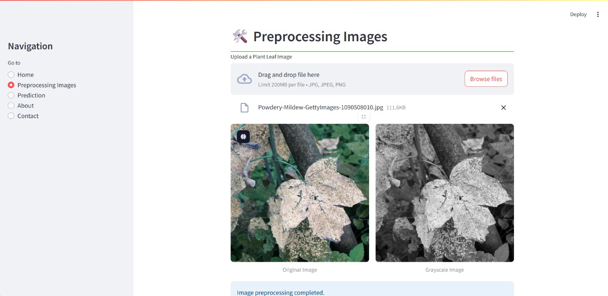
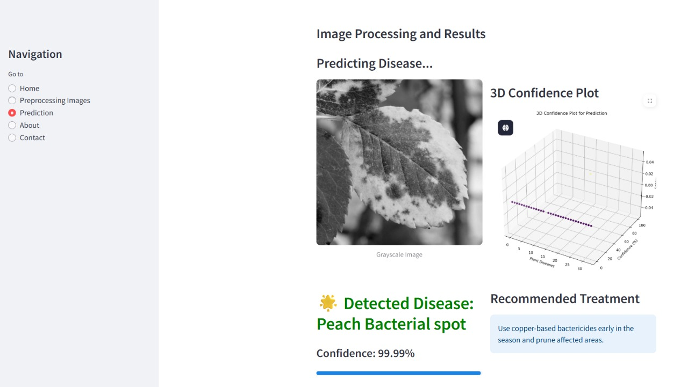

<div align="center">

# 🌿 Plant Disease Detection

### AI-powered leaf disease classification for smarter, healthier crops


</div>

---

## 📖 Overview

**Plant Disease Detection** is a deep learning application that identifies and classifies **33 types of plant leaf conditions** (healthy and diseased) from a single image. It helps farmers, agronomists, and agricultural researchers **detect diseases early, reduce crop loss, and improve yield**.

The model is built with **transfer learning** on pre-trained CNN architectures (VGG16, ResNet, EfficientNet), and served through a simple **Streamlit** web interface: upload a leaf image, get a prediction instantly.

---

## ✨ Key Features

- 🍃 **33-class classification** across healthy and diseased leaves
- 🧠 **Transfer learning** with pre-trained CNNs for strong accuracy with less training data
- 🖼️ **OpenCV preprocessing** (resizing, normalization, augmentation)
- 🌐 **Streamlit web app** with instant, upload-and-predict workflow
- 🔧 **Easy to deploy and extend** with a modular project structure

---

## 🛠️ Tech Stack

| Category | Tools |
|---|---|
| Language | Python |
| Deep Learning | TensorFlow, Keras |
| Image Processing | OpenCV |
| Web App | Streamlit |
| Utilities | NumPy, Matplotlib, scikit-learn, Flask |

---

## 📁 Project Structure

```
plant-disease-detection/
├── API/               # API-related scripts and modules
├── Media/             # Screenshots and other media assets
├── Training/          # Model training scripts and notebooks
├── app.py             # App version (Streamlit/Flask)
├── app1.py            # Alternate / test version of the app
├── main.py            # Main Streamlit app (entry point)
├── webapp.py          # Additional / legacy web app version
├── requirements.txt   # Python dependencies
└── README.md
```

---

## 📚 Dataset

- Images of **healthy and diseased leaves**
- **33 labeled categories**
- Preprocessed for training and evaluation

---

## 🔄 Workflow

```
Upload Image → Preprocess (OpenCV) → CNN Model (Transfer Learning) → Predicted Disease Class
```

---

## ⚙️ Installation & Usage

**1. Clone the repository**

```bash
git clone https://github.com/Deepika6689/plant-disease-detection.git
cd plant-disease-detection
```

**2. (Optional) Create a virtual environment**

```bash
python -m venv venv
source venv/bin/activate      # Windows: venv\Scripts\activate
```

**3. Install dependencies**

```bash
pip install -r requirements.txt
```

**4. Run the app**

```bash
streamlit run main.py
```

Then open the local URL shown in your terminal (usually `http://localhost:8501`).

> **Note:** Key package versions are listed in `requirements.txt`: `tensorflow>=2.3.1`, `numpy>=1.18.5`, `keras>=2.4.3`, `streamlit>=1.27.1`, `opencv-python>=4.7.0.68`, `matplotlib>=3.3.2`, `scikit-learn>=0.9`, `flask>=1.1.2`.

---

## 🖼️ Results

### 1️⃣ Preprocessing
Input leaf images are resized, normalized, and augmented before being passed to the model.



### 2️⃣ Prediction
Sample output after uploading a leaf image to the app.



---

## 🔮 Future Scope

- [ ] Mobile camera app integration
- [ ] Real-time disease alert system
- [ ] Integration with weather and soil data for precision agriculture
- [ ] Treatment and prevention recommendations per detected disease

---

## 🤝 Contributing

Contributions, issues, and feature requests are welcome!
Feel free to fork the repo and open a pull request.

---

## 👩‍💻 Author

**Deepika Sajjan**
GitHub: [@Deepika6689](https://github.com/Deepika6689)

<div align="center">

If you found this project useful, consider giving it a ⭐

</div>
